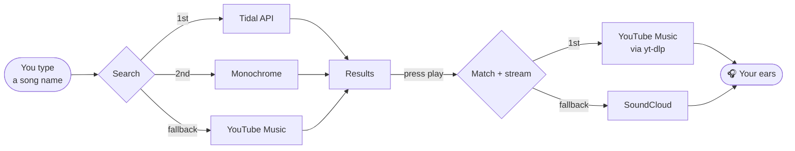

<h1 align="center">Droplet</h1>

A self-hosted music player that looks sick asf.


---

> [!NOTE]
> Droplet is a fork-in-spirit of [x8rr/music](https://github.com/x8rr/music). Same idea (Tidal catalog, YouTube audio), rebuilt in plain JavaScript with a shinier coat of paint.

## 🚀 Quick start

You need **Node.js 22 or newer**. That's it. Really.

```bash
# 1. Grab the dependencies (takes a few seconds, the coffee can wait)
npm install

# 2. Download yt-dlp into ./bin, which does the actual audio fetching
npm run setup

# 3. Fire it up
npm run dev
```

Open **http://localhost:2010** and search for something. Done. 🎉

> [!TIP]
> `npm run dev` restarts the server whenever you change backend code. Use `npm start` when you just want it to run quietly.

## 🎛️ Configuration

Everything works out of the box. If you want to tweak things, copy the example file and edit it:

```bash
cp .env.example .env
```

| Variable | Default | What it does |
|---|---|---|
| `PORT` | `2010` | Where the app lives. |
| `TIDAL_CLIENT_ID` / `TIDAL_CLIENT_SECRET` | *(empty)* | Turns on the official Tidal API. Free app at [developer.tidal.com](https://developer.tidal.com/dashboard). |
| `MONOCHROME_INSTANCES` | built-in list | Comma-separated hifi-api servers. Public ones come and go like socks in a dryer. |
| `SEARCH_PROVIDERS` | `tidal,monochrome,ytmusic` | Who to ask for search results, in order. Also accepts `soundcloud`. |
| `PLAYBACK_PROVIDERS` | `ytmusic,soundcloud` | Where to look for the actual audio, in order. |
| `YT_DLP_PATH` | `./bin/yt-dlp` | Use your own yt-dlp if you have one. |
| `INVIDIOUS_INSTANCE` | *(empty)* | Plan B for YouTube audio if yt-dlp gets blocked. |

> [!IMPORTANT]
> Without Tidal credentials **and** with no live Monochrome servers (common lately), search quietly falls back to YouTube Music. The app tells you when that happens, so you're never left wondering.

## 🧠 How it works



Matches are saved in `data/matches.json`, so the same song never gets looked up twice. Picked the wrong upload? Use **⋮ → Wrong song? Find another match** and it searches again.

## 🗂️ Project layout

```
music-api/
├── src/                          # the backend (Node + Fastify)
│   ├── server.js                 # where it all begins
│   ├── config.js                 # reads your .env so you don't have to
│   ├── lib/                      # small helpers: cache, http, JSON store, match scoring, yt-dlp
│   ├── providers/
│   │   ├── search/               # tidal.js, monochrome.js, ytmusic.js + the fallback chain
│   │   └── playback/             # youtube-music.js, soundcloud.js + the matchmaker
│   └── routes/                   # catalog, stream/download, likes, cover-art proxy
├── public/                       # the frontend (no build step, no framework, no drama)
│   ├── index.html
│   ├── assets/logo.svg           # the droplet 💧
│   ├── css/
│   │   ├── tokens.css            # colours, sizes, the vibe
│   │   ├── glass.css             # the liquid glass material
│   │   ├── layout.css            # shell, sidebar, search, toasts
│   │   ├── components.css        # buttons, cards, track rows
│   │   ├── views.css             # home, search, album, artist pages
│   │   ├── player.css            # player pill + now playing
│   │   └── responsive.css        # laptops, tablets, phones
│   └── js/
│       ├── app.js                # wires everything together
│       ├── glass.js              # SVG refraction filters (the fancy bit)
│       ├── theme.js              # steals colours from cover art
│       ├── visualizer.js         # bars + bass pulse
│       ├── player.js             # queue, shuffle, repeat, media keys
│       ├── components/ · views/  # UI pieces and pages
│       └── …                     # api, router, likes, history, icons, helpers
├── scripts/install-yt-dlp.js
└── data/                         # created on first run: likes, matches, audio cache (gitignored)
```

## ⌨️ Shortcuts

| Key | Does |
|---|---|
| <kbd>Space</kbd> / <kbd>K</kbd> | Play / pause |
| <kbd>←</kbd> <kbd>→</kbd> | Seek 10 seconds |
| <kbd>Shift</kbd> + <kbd>←</kbd> <kbd>→</kbd> | Previous / next song |
| <kbd>L</kbd> | Like the current song |
| <kbd>S</kbd> / <kbd>R</kbd> | Shuffle / cycle repeat |
| <kbd>M</kbd> | Mute (for when the boss walks by) |
| <kbd>F</kbd> | Full-screen now playing |
| <kbd>/</kbd> | Jump to search |

Right-click any song for the full menu.

## 🔌 API

Droplet is an API first; the website is just its best friend. Everything returns JSON unless it's audio.

| Method | Endpoint | Notes |
|---|---|---|
| `GET` | `/api/search?q=&source=` | `source` is optional: `tidal`, `monochrome`, `ytmusic`, `soundcloud` |
| `GET` | `/api/suggest?q=` | Search-as-you-type suggestions |
| `GET` | `/api/home` | Home feed shelves |
| `GET` | `/api/album/:source/:id` | `source` is `tidal`, `ytmusic` or `soundcloud` |
| `GET` | `/api/artist/:source/:id` | Top songs, albums, singles, similar artists |
| `GET` | `/api/playlist/:id` | YouTube Music playlists |
| `GET` | `/api/resolve?source=&id=&title=&artist=&duration=` | Which upload a track will play from. Add `&warm=1` to pre-fetch. |
| `DELETE` | `/api/resolve?…` | Forget a bad match |
| `GET` | `/api/stream?…` | The audio, with Range support (seeking works) |
| `GET` | `/api/download?…` | Same audio, as a named file download |
| `GET` · `PUT` · `DELETE` | `/api/library/likes` | Your liked songs |
| `GET` | `/api/art?u=` | Cover-art proxy (allow-listed hosts only) |

```bash
# try it
curl "http://localhost:2010/api/search?q=daft%20punk" | head -c 400
```

## 🩹 Troubleshooting

<details>
<summary><b>Nothing plays / "Couldn't play this song"</b></summary>

1. Run `npm run setup` again; yt-dlp updates often because YouTube changes often.
2. If YouTube is blocking your server, set `INVIDIOUS_INSTANCE` in `.env`.
3. Try the song from the SoundCloud source chip to rule out a bad match.
</details>

<details>
<summary><b>Search says "Monochrome didn't answer"</b></summary>

The public Monochrome servers are having a lie-down. Either add working ones to `MONOCHROME_INSTANCES`, add Tidal credentials, or just enjoy the YouTube Music results.
</details>

<details>
<summary><b>Some SoundCloud songs only play 30 seconds</b></summary>

That's SoundCloud, not us: some major-label tracks are preview-only. They're marked **PREVIEW**, sorted to the bottom, and never picked as a match.
</details>

<details>
<summary><b>The glass looks frosted but doesn't bend anything</b></summary>

Edge refraction needs a Chromium browser (Chrome, Edge, Brave, Arc…). Firefox and Safari get the frosted-glass version, which is still very pretty, we promise.
</details>

<details>
<summary><b>A long SoundCloud mix takes ages to start</b></summary>

Newer SoundCloud uploads only come in tiny chunks, so Droplet glues the whole thing together before playing. Normal songs: a few seconds. A 2-hour DJ set: go make a sandwich. 🥪
</details>

## ⚖️ The boring-but-important bit

Droplet is for personal use. Only download what you have the rights to, support the artists you love (buy the merch, go to the shows), and be nice to the community servers that make this possible.

<div align="center">
<sub>Made with 💧 and too many late-night listening sessions.</sub>
</div>
# music-api


